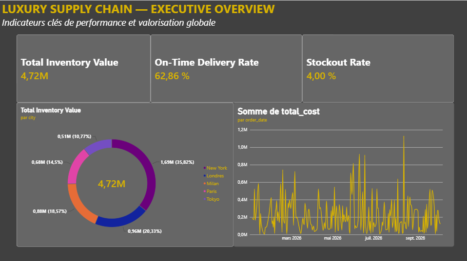
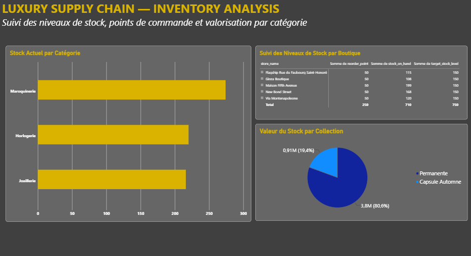
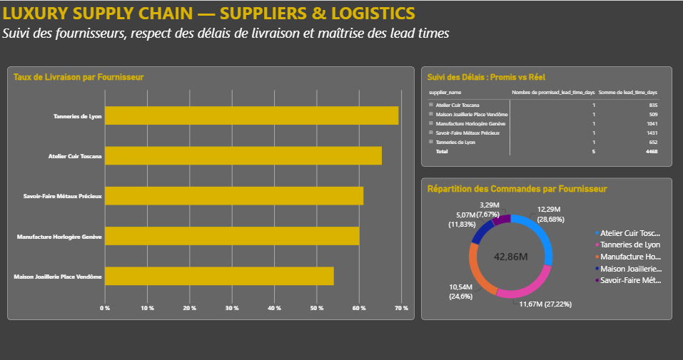

# 💎 Luxury Supply Chain Analytics — Executive & Operational Dashboard

  

---

## Executive Summary

This project delivers an end-to-end supply chain analytics platform specifically engineered for luxury fashion, leather goods, and high jewelry houses (*Maison de Luxe*). Built to reflect the operational standards of top prestige groups (**LVMH, Kering, Richemont**), this 3-page interactive Power BI solution monitors global inventory valuation, mitigates stockout risks, tracks supplier SLA performance, and optimizes end-to-end logistics lead times.

The architecture spans a robust business intelligence lifecycle:
1. **Data Modeling & Architecture:** Star Schema setup with verified core dimensional relationships.
2. **Relational Structure:** Fact-dimensional design joining stores, products, suppliers, inventory, orders, and deliveries.
3. **Interactive Visual Analytics:** Multi-page dark-mode dashboard tailored for executive decision-making.

---

## 🛠️ Technical Architecture & Stack

| Layer | Technology | Usage & Functionality |
| :--- | :--- | :--- |
| **Data Engine & Modeling** | `Power BI Data Model` | Star Schema design, 6 core relationship linkages |
| **Analytical Engine** | `DAX (Data Analysis Expressions)` | SLA tracking, stockout calculation, delivery compliance metrics |
| **Visual Analytics** | `Power BI Desktop` | Dark & Gold Luxury aesthetic, dynamic visual cross-filtering |
| **Documentation & Assets** | `Markdown / VS Code` | Technical documentation, asset structuring, screenshot mapping |

---

## 📊 Key Performance Indicators (KPIs)

- **Total Inventory Value:** `€4.72M`
- **On-Time Delivery Rate:** `62.86%`
- **Stockout Rate:** `4.00%`
- **Total Purchase Orders Volume:** `€42.86M`
- **Top Supplier On-Time Performance:** `Tanneries de Lyon (~70%)`

---

## 🖼️ Dashboard Pages & Operational Insights

### 1. Executive Overview
Focuses on macro-level operational KPIs, strategic inventory distribution by global flagship cities (Paris, New York, London, Tokyo, Milan), and overall spending trajectory over time.

  

### 2. Inventory Analysis
Delivers granular tracking of stock levels across product categories (*Maroquinerie, Horlogerie, Joaillerie*), store-level reorder threshold monitoring against targets, and inventory value split by collection type (*Permanente vs Capsule Automne*).

  

### 3. Suppliers & Logistics
Evaluates vendor compliance via On-Time Delivery rates, compares contractual promised lead times against actual logistics execution, and analyzes total order volume distribution by key suppliers.

  

---

## 🎯 Strategic Business Recommendations

### 1. Optimisation du Taux de Respect des Délais Fournisseurs (SLA)
- **Constat :** Le taux global de livraison à temps s'élève à 62,86 %, laissant plus de 37 % de livraisons en retard.
- **Action :** Auditer les processus logistiques des fournisseurs sous-performants (ex: *Maison Joaillerie Place Vendôme*) et mettre en place des pénalités d'impartage ou des clauses de soutien logistique sur le modèle des *Tanneries de Lyon*.

### 2. Réduction des Réductions de Stock et Réassort Cible
- **Constat :** Malgré un taux de rupture de stock maîtrisé (4,00 %), certaines boutiques approchent dangereusement de leur point de réassort (`reorder_point`).
- **Action :** Automatiser les déclenchements de réassort dès franchissement du seuil d'alerte vers le niveau cible (`target_stock_level`), en particulier pour la *Maroquinerie* qui représente la majorité du volume.

### 3. Gestion des Collections Capsules vs Lignes Permanentes
- **Constat :** La collection *Permanente* représente 80,6 % de la valeur stockée (€3.8M), tandis que les *Capsules* éphémères représentent 19,4 % (€0.91M).
- **Action :** Fluidifier la rotation des stocks des collections capsules pour éviter l'immobilisation financière post-saison et garantir la priorité logistique sur les permanents iconiques à forte marge.

---

  <i>Designed for Executive Analytics & Luxury Supply Chain Management</i>

